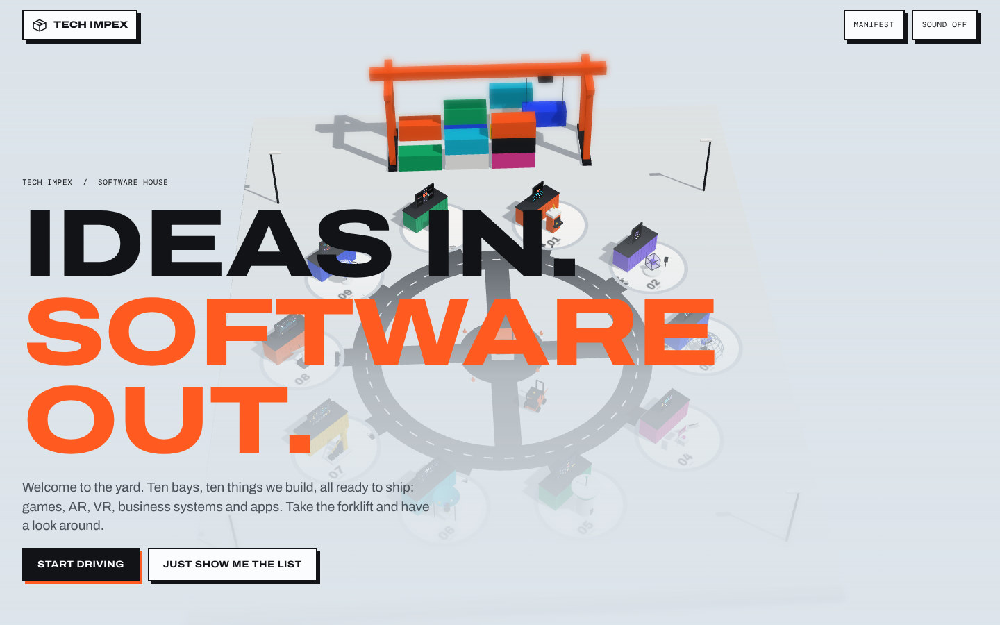
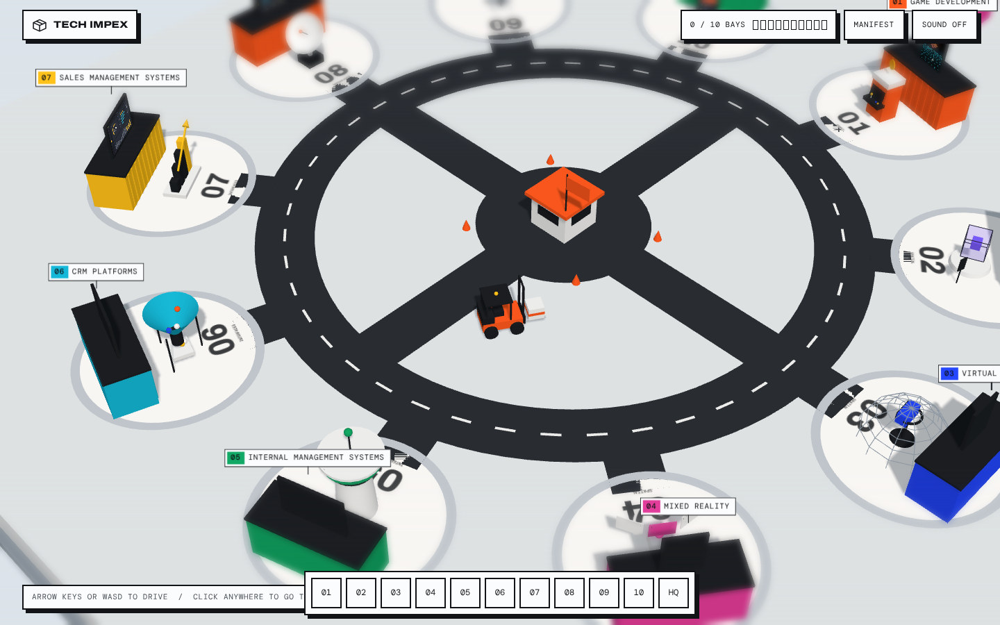

# Tech Impex: The Yard

"Ideas in. Software out." A website concept for a software house, set in a bright container yard. There is no scrolling. You drive a forklift round ten bays, one for each thing the studio builds.



Each bay has a container, a live screen and a model: an arcade cabinet, an AR hologram, a VR headset, a control tower, a CRM funnel, a sales chart, a data dish, a globe and a giant phone. Visiting a bay logs it, and visiting all ten opens a contact prompt. The Manifest button gives the plain list for anyone who would rather not drive.



## Controls

- Arrow keys or WASD to drive
- Click or tap anywhere to send the forklift there
- Scroll to zoom
- The numbered dock at the bottom jumps straight to a bay

## What is in this repo

| Path | What it is |
|---|---|
| `index.html` | The site. One file, ready to open or host. It works on desktop and on phones. |
| `src/` | Sources |
| `build.cjs` | Rebuilds `index.html` from the sources |
| `docs/` | Screenshots used on this page |

## Open it

Open `index.html` in a browser. There is nothing to install. It needs an internet connection for three.js (from cdnjs) and the fonts (from Google Fonts).

It is a single static file, so any static host will serve it.

## Change it

Edit the files in `src/`, then rebuild:

```
node build.cjs
```

The scripts in `src/js/` are joined in file name order into one script, so they share one scope and the numbers in the names set the load order. `body.html` is the page markup and `style.css` the styles. The build needs Node and nothing else.

`00-util.js`, `10-screens.js` and `20-work.js` are shared with the Dimensions concept (helpers, the live screens, and the capability and project lists). `50-yard.js` is the yard itself and `60-ui.js` its interface.

## Placeholder content to replace

Everything shown is sample content.

- **Studio name:** `STUDIO` at the top of `src/js/00-util.js`.
- **Capabilities and projects:** the `CAPS` and `PROJ` lists in `src/js/20-work.js`.
- **Contact details:** the email, phone and city in `src/js/60-ui.js`.

## Notes

- Built on three.js r128. Fonts: Archivo, DM Mono.
- Sound is off until the visitor turns it on.
- The bays show live screens but have no playable game or working sales system inside them yet. The other two concepts have both.
- Tested in a desktop browser engine at desktop and phone sizes with software rendering. It has not been tested on a physical phone yet.
